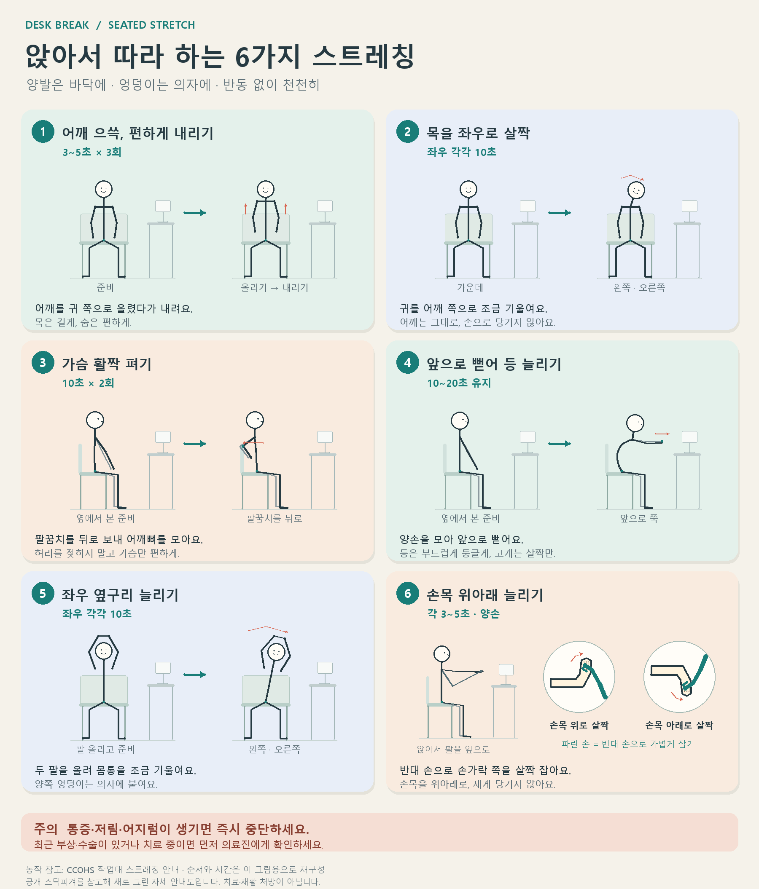

# kinds-of-thing · 틈

Windows에서 정해진 간격마다 전체 화면으로 나타나는, 내 몸과 마음을 위한 작은 휴식 알림기입니다. 알림 간격과 주제는 사용자가 선택합니다.

이 저장소는 `/mnt/c/work/desk-stretch`에서 이번 작업 중 만든 산출물만 모은 독립 저장소입니다. 다른 프로젝트의 코드나 Git 이력은 포함하지 않습니다.

## 작업 절차

작업 절차서는 [AGENTS.md](AGENTS.md)입니다. **사용자가 입력한 작업 프롬프트는 반드시 이 README에 원문으로 남깁니다.** 추가·정정 지시도 입력 순서대로 기록하며, 완료 전에 누락 여부를 확인합니다. 민감한 값은 가림 처리하고 그 사실을 표시합니다.

## 사용자 프롬프트 원문 기록

아래는 이번 대화에서 확인한 사용자 입력 원문입니다. 이후 작업의 프롬프트도 이 절에 순서대로 추가합니다. 기존 제작 과정의 요약은 다음 절에 별도로 유지합니다.

### 1. 최신 코드 동기화

```text
최신 code sync 하라
```

### 2. 작업 절차에 프롬프트 기록 의무 추가

```text
작업 절차서에, 입력한 prompt 를 README 에 반드시 남겨라 추가
```

### 3. 03번 타일에 다른 사람이 공유한 쉼을 GitHub로 동기화

```text
"03어떤 작은 쉼이 필요하세요?"  여기 tile item 에는 다른 사람이 공유한 내용으,ㄹ sync 하여 추가되게 하고자 한다. 저장소는 본 project 의 gituh 저장소이고, display 호환되는 형태로 github 에 올리는 공유 메뉴와, 공유된 것을 실시간 추가하도록 App 이 기능이 있을것
```

### 4. 시 한 줄 채우기 작품 확장과 무작위 출제

```text
잠깐 쉬어가도 괜찮아요
시 한 줄 채우기  -->  파트의 경우, 인터넷에서 최신 서정시나, 노랫가사, 노벨 문학상 작품 등 다양한 시 100 편 이상을 다루고, 질문 하는 line 도 random하게 선택가능
```

### 5. 일어나 움직이기 테마에 최신 스포츠 스트레칭 동작 포함

```text
"허리 편한 휴식 · 일어나 움직이기" --> 이 것은 최신 스포츠 스트레칭 동작등 과격하더라도 과한 동작을 포함할 것
```

### 6. 스포츠 과학 스트레칭 분야로 확장

```text
스포츠 과학 스트레칭 분야로 확장
```

### 7. DeskHooker.exe 재빌드 반영

```text
DeskHooker.exe 재빌드해서 반영해
```

### 8. 커밋 및 푸시

```text
커밋해서 푸시해
```

### 9. UI 스모크 테스트 실행

```text
UI 스모크 테스트 돌려봐
```

### 10. DeskHooker.cs와 exe만 먼저 커밋·푸시

```text
DeskHooker.cs와 exe만 먼저 커밋해서 푸시해
```

### 11. 알림 간격을 프리셋 대신 직접 입력한 분 단위로 변경

```text
01어느 간격으로 만날까요?
1
분에 한 번
15분
30분
45분
60분
90분
120분

 은 정해진 시간을 입력하여 몇 분마다로 수정하자.
```

### 12. exe 재빌드와 테스트 실행

```text
exe 다시 빌드하고 테스트 돌려줘
```

### 13. 시 라이브러리 UI 테스트 실패 원인 수정

```text
시 라이브러리 실패 원인 찾아서 고쳐줘
```

### 14. 변경사항 커밋

```text
변경사항 커밋해줘
```

### 15. 푸시

```text
푸시해줘
```

### 16. node --test 실패 원인 조사

```text
node --test 실패 원인 찾아줘
```

### 17. 커밋과 푸시

```text
커밋하고 푸시해줘
```

### 16. UI 스모크 테스트 재실행

```text
UI 스모크 테스트 다시 돌려봐
```

### 17. exe와 README 커밋·푸시

```text
exe와 README 커밋해서 푸시해
```

### 18. 간격 설정에 몇 시부터·간격 얼마 형태의 절대 시간 입력 추가

```text
01어느 간격으로 만날까요?
1
분마다
1~240 사이의 분을 직접 입력하세요.
팝업을 닫은 시점부터 다음 간격을 다시 셉니다.

 에서 몇시부터 간격 얼마, 이렇게 절대 시간 입력이 가능하게 하라.
```

### 19. 시·분 단위 입력란 추가 지시 (작업 중 추가 입력)

```text
즉 몇 시 몇 분 입력하는 곳이 없으니 추가하라.
```

### 20. 종료 후 exe 재빌드와 UI 테스트 실행

```text
DeskHooker 종료했으니 다시 빌드하고 UI 테스트 돌려
```

### 21. 변경사항 커밋 및 푸시

```text
변경사항 커밋해서 푸시해
```

### 22. UI 테스트에 시:분 입력 항목 추가

```text
UI 테스트에 시:분 입력 항목 추가해
```

### 23. 종료 후 exe 재빌드와 UI 테스트 재실행

```text
DeskHooker 종료했으니 다시 빌드하고 UI 테스트 돌려
```

### 24. PID 4212 종료 허용 후 빌드와 UI 테스트 실행

```text
4212 종료해도 되니까 빌드하고 UI 테스트 돌려
```

### 25. 변경사항 커밋 및 푸시 (시:분 UI 테스트)

```text
변경사항 커밋해서 푸시해
```

### 26. 걸그룹 안무 영상 추가, 구간 반복·속도 조절 기능 요청

```text
잠깐 쉬어가도 괜찮아요
걸그룹 안무
공식 안무 영상으로 원본 동작 따라 보기     --> 여기 내용 더 가지수 추가하고, 특정 동작을 반복하기, 속도 조절하기 기능 추가 가능 한가 ?
```

### 27. 안무 기능 반영을 위한 exe 재빌드와 UI 테스트

```text
exe 다시 빌드하고 UI 테스트 돌려
```

### 28. 변경사항 커밋 및 푸시 (안무 영상·속도·구간 반복)

```text
변경사항 커밋해서 푸시해
```

### 29. 안무 화면 UI 테스트 추가

```text
안무 화면 UI 테스트에 추가해
```

### 30. 종료 후 exe 재빌드와 UI 테스트 실행 (안무 화면 테스트 포함)

```text
DeskHooker 종료했으니 다시 빌드하고 UI 테스트 돌려
```

### 31. 변경사항 커밋 및 푸시 (안무 화면 UI 테스트)

```text
변경사항 커밋해서 푸시해
```

### 32. 즉시 실행 시험 버튼 추가

```text
부터 매 x 분마다 실행  말고 즉시 실행 버튼 하나 추가하라, 시험하는 사람이 시험가능하게 버튼 추가
```

### 33. 즉시 실행 버튼 반영을 위한 exe 재빌드와 UI 테스트

```text
exe 다시 빌드하고 UI 테스트 돌려
```

### 34. 안무 속도 조절 직접 확인 결과 보고

```text
DeskHooker 실행해서 안무 속도 조절 직접 확인할게, 정상동작함
```

### 35. 변경사항 커밋 및 푸시 (즉시 실행 버튼, 안무 속도 확인 기록)

```text
변경사항 커밋해서 푸시해
```

### 36. 다중 선택 시 실행 방식(순차/랜덤, 전체/하나씩) 선택 기능 요청

```text
03어떤 작은 쉼이 필요하세요?
0개 선택 · 목록 순서
공유된 쉼 2개 · 오후 05:01에 확인 · 약 10분마다 자동 확인   --> 여기 내용 항목들 중에서, 선택이 여럿일 경우ㅡ 다중 선택을어떻게 실행할지 선택하는 방법 제공하라,  (1) 실행되면 모든것을 순차로 다 실행,   (2) 실행되면 모든것을 랜덤으로 순서 바꾸어 다 실행,  (3) 한번에 하나만 선택하되 순서는 정해진대로 하나씩,  (4) 한번에 하나만 선택하되  순서는 랜덤하게 하나만 ....
```

### 34. 변경사항 커밋 및 푸시 (즉시 실행 버튼)

```text
변경사항 커밋해서 푸시해
```

### 37. 실행 방식 선택 기능 UI 테스트 실행

```text
UI 테스트 실행해
```

### 38. 변경사항 커밋 및 푸시 (다중 선택 실행 방식)

```text
변경사항 커밋 및 푸시해
```

### 35. 즉시 실행 버튼 UI 테스트 추가

```text
즉시 실행 버튼 UI 테스트에 추가해
```

### 36. 종료 후 exe 재빌드와 UI 테스트 실행 (즉시 실행 버튼 테스트 포함)

```text
DeskHooker 종료했으니 다시 빌드하고 UI 테스트 돌려
```

### 37. 변경사항 커밋 및 푸시 (즉시 실행 버튼 UI 테스트)

```text
변경사항 커밋해서 푸시해
```

### 38. 실행 방식 수정사항 빌드 및 직접 시험 요청, "다음 쉼" 버튼 요청

```text
여기 수정사항 빌드해서 직접 시험하게 해줘

여러 개를 골랐을 때 실행 방식
모두 순서대로
모두 무작위 순서로
하나씩 순서대로
하나만 무작위로
알림이 오면 고른 쉼을 목록 순서대로 전부, 하나가 끝나면 이어서
: 여러개 순서대로 이면, 닫기를 눌러도 각각 하나씩 다음을 시행해야 하지 않나 ? 즉 닫기 버튼 왼쪽에 다음것 실행  버튼이 있어야 할듯

여러 개를 골랐을 때 실행 방식
모두 순서대로
모두 무작위 순서로
하나씩 순서대로
-- 여기서 모두 순서대로와 vs  하나씩 순서대로 간의 차이를 볼때,  모두은 이번에 실행할 action을 다 순차로 시행하는 것이야
```

(붙여넣은 화면에서 잘린 부분은 복원하지 않았습니다. 이어서 도착한 "." 한 글자 메시지는 지시 없음으로 처리했습니다.)

### 39. 직접 시험용 빌드 요청, "모두" 방식에서 다음 쉼 실행 버튼 요청 (붙여넣기 포함 원문)

```text
여기 수정사항 빌드해서 직접 시험하게 해줘
<pasted_content id="f0ae">
여러 개를 골랐을 때 실행 방식
모두 순서대로
모두 무작위 순서로
하나씩 순서대로
하나만 무작위로
알림이 오면 고른 쉼을 목록 순서대로 전부, 하나가 끝나면 이어서
</pasted_content id="f0ae">

 : 여러개 순서대로 이면, 닫기를 눌러도 각각 하나씩 다음을 시행해야 하지 않나 ? 즉 닫기 버튼 왼쪽에 다음것 실행  버튼이 있어야 할듯
<pasted_content id="f0ae">
여러 개를 골랐을 때 실행 방식
모두 순서대로
모두 무작위 순서로
하나씩 순서대로
</pasted_content id="f0ae">

  -- 여기서 모두 순서대로와 vs  하나씩 순서대로 간의 차이를 볼때,  모두은 이번에 실행할 action을 다 순차로 시행하는 것이야
.
.
현재 상황은 ?
Hi
.
.
.
.
.
.
.
.
```

### 39. UI 테스트 실행

```text
UI 테스트 돌려
```

### 40. 커밋 요청

```text
커밋 하라,.
```

### 41. 실행 방식 메뉴를 왼쪽 사이드바에 추가

```text
다음 "

여러 개를 골랐을 때 실행 방식
모두 순서대로
모두 무작위 순서로
하나씩 순서대로
하나만 무작위로
두 개 이상 고르면 아래 방식으로 실행돼요.

" 이 메뉴를 왼쪽사이드바에 추가해
```

### 42. 종료 후 exe 재빌드와 UI 테스트 실행 (사이드바 실행 방식 메뉴)

```text
DeskHooker 종료했으니 다시 빌드하고 UI 테스트 돌려
```

### 43. 내 쉼 공유하기를 클릭했을 때만 팝업으로 설정

```text
"내 쉼 공유하기 · GitHub에 올려 다른 사람 앱에도 나타나게" 는 이 기능이 필요한 action 을 선택하여 클릭 했을때만 popup 으로 설정하게 수정하라
```

### 44. 변경사항 커밋 및 푸시 (사이드바 실행 방식, 공유 팝업)

```text
변경사항 커밋해서 푸시해
```

### 45. 다음 쉼 버튼과 사이드바 메뉴를 UI 테스트에 추가

```text
다음 쉼 버튼과 사이드바 메뉴를 UI 테스트에 추가해
```

### 46. 호흡·발성 가이드 시간 설정의 사용 시점 질문

```text
"

호흡·발성 가이드 시간 직접 고르기
들숨 
4
초
멈춤 
0
초
날숨 
6
초
기본은 숨참기 없이 들숨 4초·날숨 6초입니다. 숫자를 끝까지 채우려 하지 말고 편안한 만큼만 하세요. 멈춤은 선택 사항이며 최대 30초입니다. 몸 상태에 따른 제한이 있으면 의료진에게 먼저 확인하세요. 과호흡 후 숨참기, 힘주어 버티기는 하지 마세요.

멈춤은 필수가 아니며 불편하면 즉시 편안한 호흡으로 돌아가야 함을 확인했습니다.

" 이 버튼은 언제 사용되나 ?  이것을 사용하는 action item 을 클릭하여 popup 나온다음 설저하면 안되나 ?
```

### 47. 호흡 시간 설정을 팝업에서 바로 저장되게 구현

```text
팝업에서 바로 저장되게 구현해
```

### 48. 변경사항 커밋 및 푸시 (호흡 시간 팝업 저장, UI 테스트 추가)

```text
변경사항 커밋해서 푸시해
```

### 49. 직접 실행 시험 결과 보고

```text
DeskHooker 실행해서 직접 시험해볼게, 정상이다.
```

### 50. 발성 주제에 음성 안내 삽입 가능 여부 질문

```text
"잠깐 쉬어가도 괜찮아요
발성 · 아주 가벼운 허밍
편한 음높이와 작은 일상 목소리 크기로 짧게 허밍하고 쉬는 무음 미리보기입니다."  --> 이거 음성 안내 삽입 가능한가 ?
```

### 51. 발성·호흡 주제에 음성 안내(방법 A) 구현

```text
방법 A로 발성·호흡 둘 다 넣어줘
```

### 52. 종료 후 exe 재빌드와 UI 테스트 실행 (음성 안내)

```text
DeskHooker 종료했으니 다시 빌드하고 UI 테스트 돌려
```

### 53. 변경사항 커밋 및 푸시 (음성 안내)

```text
변경사항 커밋해서 푸시해
```

### 54. 앉아서 스트레칭 하위 목록 확장 (기본 #1, 영상 #2)

```text
↟

앉아서 스트레칭
기존에 승인된 어깨·목·등·옆구리·손목 스트레칭 미리보기입니다.

미리 보기  --> 여기 내용을 안에서 여러가지가 표시될 수 있게확장하자, 즉 하위에 수십가지 list 로 가지고 그 중에 하나씩 순차로 보이거나 랜덤하게 하거나 등, 그 후보로  기본 item #1 은 지금 것 그대로, 추가로 영상 은 #2 로 https://www.youtube.com/shorts/Md24PbVP72U
```

### 55. 하위 목록 확장 가능 여부 확인 (54번에 이어서 도착)

```text
가능한가 ?
```

### 56. 하위 목록 #3 영상 추가 (54번에 이어서 도착)

```text
#3 = https://www.youtube.com/shorts/-yOiTWEgU_Y
```

### 57. 하위 목록 #4 영상 추가 (54번에 이어서 도착)

```text
# 4 https://www.youtube.com/shorts/-_Oqek7ARlk
```

### 58. 하위 목록 #5 영상 추가

```text
#5 https://www.youtube.com/watch?v=2DRvc74GgYM
```

### 59. 하위 목록 #6 영상 추가

```text
#6 https://www.youtube.com/watch?v=5fnEEzi_ev0
```

### 60. 하위 목록 #7 영상 추가

```text
#7 https://www.youtube.com/shorts/QteVMsNU3dk
```

### 61. 하위 목록 #8 영상 추가

```text
#8 https://www.youtube.com/shorts/ngbWg9WUMoE
```

### 62. 하위 목록에 영상 추가 (번호가 #8로 중복되어 #9로 추가)

```text
#8 https://www.youtube.com/watch?v=VF20iXwq29U
```

### 63. 하위 목록 #10 영상 추가

```text
#10 https://www.youtube.com/shorts/dNZ2aJp2rwI
```

### 64. 앱 종료 알림 (재빌드·UI 테스트 진행으로 해석)

```text
#11 종료했으니
```

### 65. 하위 목록 #11 영상 추가

```text
#11 https://www.youtube.com/shorts/02pSlIL7lig
```

### 66. 하위 목록 #12 영상 추가

```text
#12 https://www.youtube.com/shorts/A50ClACVyFE
```

### 67. 하위 목록 #13 영상 추가

```text
#13 https://www.youtube.com/watch?v=Q7ogtZAplLM
```

### 68. 하위 목록 #14 영상 추가

```text
#14 https://www.youtube.com/watch?v=u5GPq0CC7U8
```

### 69. 하위 목록 #15 영상 추가

```text
#15 https://www.youtube.com/shorts/HCjvbjbCSsk
```

### 70. 종료 후 exe 재빌드와 UI 테스트 실행 (스트레칭 하위 목록)

```text
DeskHooker 종료했으니 다시 빌드하고 UI 테스트 돌려
```

### 71. "허리 편한 휴식 · 일어나 움직이기" 하위 목록에 영상 추가

```text
↗

허리 편한 휴식 · 일어나 움직이기
스포츠 과학의 동적 스트레칭·가동성 드릴·PNF·플라이오 활성화를 짧게 맛보는 강도 높은 일어서기 휴식입니다.

 - 를 위한 항목으로는 #1 https://www.youtube.com/shorts/N-V53dmXJ9M
```

### 72. "일어나 움직이기" 하위 목록 #2 영상 추가 (71번에 이어서 도착)

```text
#2 https://www.youtube.com/shorts/qB7oUZeiV98
```

### 73. "일어나 움직이기" 하위 목록 #3 영상 추가 (71번에 이어서 도착)

```text
#3 https://www.youtube.com/shorts/exQ8fzkiZjg
```

### 74. 하위 목록 #5 영상 추가 ("일어나 움직이기" 목록의 이어서로 해석)

```text
#5 https://www.youtube.com/watch?v=uw1aUHnMfo8
```

### 75. 종료 후 exe 재빌드와 UI 테스트 실행 (하위 목록 일반화)

```text
DeskHooker 종료했으니 다시 빌드하고 UI 테스트 돌려
```

### 76. 영상 항목은 안내문 없이 가운데 영상 하나만, 자동 재생

```text
(붙여넣은 화면: "앉아서 스트레칭" 팝업. 상단 "4 / 15", 보여 주는 순서 "무작위", #1~#15 목록, 영상 설명 문구, "YouTube에서 열기 ↗", "천천히 따라 해 보세요" 안내 4줄과 안전 문구)

 --> 여기서 유튜브 영상을 보일때는 

(붙여넣은 내용: "천천히 따라 해 보세요 / 양발을 바닥에 두고 안정된 의자에 앉아요. / 화면의 여섯 동작을 통증 없는 작은 범위에서 천천히 해요. / 손으로 세게 당기거나 반동을 주지 않고 평소처럼 숨 쉬어요. / GIF 재생 속도를 따라갈 필요는 없어요.")

 는 보일 필요가 없어, 그냥 화면 한 가운데 꽌찬 영상 하나만, 그리고자동 start 해 사용자가 play 누르지 않게
```

(긴 붙여넣기 화면은 핵심 구조만 요약해 표시했습니다. 사용자가 입력한 문장은 원문 그대로입니다.)

### 77. 종료 후 exe 재빌드와 UI 테스트 실행 (영상 가운데 표시·자동 재생)

```text
DeskHooker 종료했으니 다시 빌드하고 UI 테스트 돌려
```

### 78. 종료 후 exe 재빌드와 UI 테스트 재요청

```text
DeskHooker 종료했으니 다시 빌드하고 UI 테스트 돌려
```

### 79. 변경사항 커밋 및 푸시 (하위 목록, 영상 자동 재생)

```text
변경사항 커밋해서 푸시해
```

### 80. 명상 주제는 기존 내용을 없애고 영상 #1로 교체

```text
(붙여넣은 내용: "◌ / 명상 · 자연스러운 숨 / 호흡을 바꾸지 않고 지금 느껴지는 숨으로 주의를 돌리는 짧은 휴식입니다.")

 여기 분야는 기존것은 없애고, #1 https://www.youtube.com/watch?v=6Qu5E3MrVH8
```

### 81. 명상 하위 목록 #2 영상 추가 (80번에 이어서 도착)

```text
#2 https://www.youtube.com/watch?v=LaM3-_ntnjU
```

### 82. 종료 후 exe 재빌드와 UI 테스트 실행 (명상 영상 목록)

```text
DeskHooker 종료했으니 다시 빌드하고 UI 테스트 돌려
```

### 83. 명상 하위 목록 #3 영상 추가

```text
#3 https://www.youtube.com/watch?v=PdeV5CLt2_E
```

### 84. 재빌드 요청

```text
다시 빌드해
```

### 85. 명상 하위 목록 #4 영상 추가 ("명상" 목록의 이어서로 해석)

```text
#4 https://www.youtube.com/watch?v=Og_Qli3M_nE
```

### 86. 변경사항 커밋 및 푸시 (명상 영상 목록)

```text
변경사항 커밋해서 푸시해
```

### 87. "의자 요가 · 가볍게 뻗기" 카드 삭제

```text
(붙여넣은 내용: "잠깐 쉬어가도 괜찮아요 / 의자 요가 · 가볍게 뻗기 / 앉은 자세에서 팔을 편하게 올리고 옆으로 조금 기울이는 요가 느낌의 동작입니다.")

  -- 이 카드는 삭제
```

### 88. 종료 후 exe 재빌드와 UI 테스트 실행 (의자 요가 카드 삭제)

```text
DeskHooker 종료했으니 다시 빌드하고 UI 테스트 돌려
```

### 89. 걸그룹 안무 영상은 선택하면 자동 재생

```text
(붙여넣은 내용: "닫기 × Esc / 잠깐 쉬어가도 괜찮아요 / 걸그룹 안무 / 공식 안무 영상으로 원본 동작 따라 보기")

 --> 여기서 선택 하면 play 는 자동으로 시작하게 수정해
```

### 90. "일어나 움직이기" 하위 목록에 영상 추가 (89번 작업 중 도착)

```text
잠깐 쉬어가도 괜찮아요
허리 편한 휴식 · 일어나 움직이기
스포츠 과학의 동적 스트레칭·가동성 드릴·PNF·플라이오 활성화를 짧게 맛보는 강도 높은 일어서기 휴식입니다.  --ㅇ. 여기에 영상 추가 https://www.youtube.com/watch?v=EF_jq5ZaZMI
```

### 91. 종료 후 exe 재빌드와 UI 테스트 실행 (안무 자동 재생, 일어나 움직이기 영상)

```text
DeskHooker 종료했으니 다시 빌드하고 UI 테스트 돌려
```

### 92. "일어나 움직이기" 하위 목록에 영상 추가

```text
일어나 움직이기 영상추가 https://www.youtube.com/watch?v=EN6IpNi45_E
```

### 93. 변경사항 커밋 및 푸시 (의자 요가 삭제, 안무 자동 재생, 일어나 움직이기 영상)

```text
변경사항 커밋해서 푸시해
```

### 94. "필라테스 느낌 · 자세 인식" 카드 삭제

```text
(붙여넣은 내용: "↥ / 필라테스 느낌 · 자세 인식 / 허리를 젖히지 않고 편하게 길어진 자세와 어깨뼈 움직임을 느끼는 초보용 미리보기입니다.")

 카드는 삭제해
```

### 95. 필라테스 카드 삭제 재요청

```text
(붙여넣은 내용: "↥ / 필라테스 느낌 · 자세 인식 / 허리를 젖히지 않고 편하게 길어진 자세와 어깨뼈 움직임을 느끼는 초보용 미리보기입니다.")

 -카드 자체를 없애라
```

### 96. 재빌드 요청

```text
다시 빌드해
```

### 97. "코어 · 배의 감각 알아차리기" 카드 삭제

```text
(붙여넣은 내용: "◎ / 코어 · 배의 감각 알아차리기 / 편한 자세와 정상 호흡을 유지하며 배 주변에 아주 약한 힘을 주었다 푸는 동작입니다. / 미리 보기 ↗")

 - 카드 자체를 제거해
```

### 98. 종료 후 exe 재빌드와 UI 테스트 실행 (필라테스·코어 카드 삭제)

```text
DeskHooker 종료했으니 다시 빌드하고 UI 테스트 돌려
```

### 99. "허리 편한 휴식 · 앉은 자세 바꾸기" 카드 삭제

```text
(붙여넣은 내용: "↕ / 허리 편한 휴식 · 앉은 자세 바꾸기 / 정답 자세를 강요하지 않고 골반 위치와 어깨를 편하게 바꾸는 앉은 휴식입니다.")

 - 카드도 삭제해
```

### 100. "목 풀기 한 번" 카드 제거

```text
(붙여넣은 내용: "✿ / 목 풀기 한 번 / 고개를 천천히 기울여 목 옆을 부드럽게 푸는 쉼")

 - 이것도 제거해
```

### 101. "눈 쉬기 20-20-20" 기존 내용을 없애고 영상 #1로 교체

```text
(붙여넣은 내용: "✿ / 눈 쉬기 20-20-20 / 화면에서 눈을 떼고 먼 곳을 바라보는 짧은 쉼")

 - sodyddp 기존 것은 삭제하고, #1 https://www.youtube.com/shorts/356wdTdVaTs
```

### 102. "눈 쉬기 20-20-20" 하위 목록 #2 영상 추가

```text
#2 https://www.youtube.com/shorts/2oojWWfappA
```

### 103. "호흡 · 편안하게 내쉬기" 하위 목록 #2 영상 추가

```text
호흡 · 편안하게 내쉬기
무리 없이 들이쉬고 가능할 때만 조금 더 여유 있게 내쉬는 호흡 미리보기입니다.  --> 여기에 #2 https://www.youtube.com/shorts/7HQqs-wdGVo
```

### 104. "호흡 · 편안하게 내쉬기" 하위 목록 #3 영상 추가 (103번에 이어서 도착)

```text
#3 https://www.youtube.com/shorts/eR4DYL9GS0U
```

### 105. "호흡 · 편안하게 내쉬기" 하위 목록 #4 영상 추가 (호흡 목록의 이어서로 해석)

```text
#4 https://www.youtube.com/shorts/yCoZfAeJTnQ
```

### 106. 종료 후 exe 재빌드와 UI 테스트 실행 (호흡·눈 쉬기 영상, 카드 삭제)

```text
DeskHooker 종료했으니 다시 빌드하고 UI 테스트 돌려
```

### 107. 발성 주제는 기존 내용을 지우고 영상 #1로 교체

```text
(붙여넣은 내용: "♪ / 발성 · 아주 가벼운 허밍 / 편한 음높이와 작은 일상 목소리 크기로 짧게 허밍하고 쉬는 미리보기입니다. 음성 안내는 선택으로 켤 수 있어요.")

 - 여기 기존 내용지우고, #1 https://www.youtube.com/shorts/88TBCVp-Tlc
```

### 108. 발성 하위 목록 #2 영상 추가 (107번에 이어서 도착)

```text
#2 https://www.youtube.com/watch?v=x6y6SPzCQXQ
```

### 109. 종료 후 exe 재빌드와 UI 테스트 실행 (발성 영상)

```text
DeskHooker 종료했으니 다시 빌드하고 UI 테스트 돌려
```

### 110. 발성 하위 목록 #3~#5 영상 추가 (108번에 이어서 도착)

```text
#3 https://www.youtube.com/watch?v=YdBUnWJBYAo
#4 https://www.youtube.com/watch?v=YLfFw6IuVqc
#5 https://www.youtube.com/watch?v=43MKF1bL_mM
```

### 111. "호흡 · 편안하게 내쉬기" 카드 삭제

```text
잠깐 쉬어가도 괜찮아요
호흡 · 편안하게 내쉬기,
무리 없이 들이쉬고 가능할 때만 조금 더 여유 있게 내쉬는 호흡 미리보기입니다.   이 부분 카드를 없애라
```

### 112. 종료 후 exe 재빌드와 UI 테스트 실행 (호흡 카드 삭제)

```text
DeskHooker 종료했으니 다시 빌드하고 UI 테스트 돌려
```

### 113. "걸그룹 안무" 제목을 "댄스 안무"로 수정

```text
걸그룹 안무
공식 안무 영상으로 원본 동작 따라 보기  -->  "댄스 안무" 로 제목 수정해
```

### 114. 종료 후 exe 재빌드와 UI 테스트 실행 (댄스 안무 제목)

```text
DeskHooker 종료했으니 다시 빌드하고 UI 테스트 돌려
```

### 115. 변경사항 커밋 및 푸시 (카드 정리, 영상 목록, 댄스 안무 제목)

```text
변경사항 커밋해서 푸시해
```

### 116. "목 풀기 한 번" 카드 제거 재요청

```text
목 풀기 한 번
고개를 천천히 기울여 목 옆을 부드럽게 푸는 쉼  -- 카드 제거해
```

### 117. 변경사항 커밋 및 푸시 (프롬프트 기록)

```text
변경사항 커밋해서 푸시해
```

### 118. "시 한 줄 채우기" 카드를 없애고 테트리스 게임 카드로 교체

```text
시 한 줄 채우기
다양한 시·노랫말·노벨 문학상 작품에서 무작위 한 줄   --이 카드 없애고,  다른 카드로, 테트리스 게임
```

### 119. 종료 후 exe 재빌드와 UI 테스트 실행 (테트리스 카드)

```text
DeskHooker 종료했으니 다시 빌드하고 UI 테스트 돌려
```

### 120. 테트리스 카드 이름을 "게임"으로 변경

```text
테트리스
블록을 쌓아 줄을 지우는 짧은 게임 한 판  --> "테트리스" 대신 "게임" 으로 이름 변경
```

### 121. 종료 후 exe 재빌드와 UI 테스트 실행 (게임 카드 이름)

```text
DeskHooker 종료했으니 다시 빌드하고 UI 테스트 돌려
```

### 122. 게임 카드 이름 변경 후 재빌드 확인, 댄스 안무 하위 항목 자동 선택·재생 요청

```text
(붙여넣은 내용: "닫기 × Esc / 잠깐 쉬어가도 괜찮아요 / 댄스 안무 / 공식 안무 영상으로 원본 동작 따라 보기 ..." 안무 안내문과 TWICE·BLACKPINK·IVE·LE SSERAFIM 영상 8개 목록 카드 (긴 화면 붙여넣기는 구조만 요약해 표시했습니다))

  여기 내용도 하위 항목을 순차 혹은 랜덤하게 선택하에 시작하라.

하위 블록은 의미가 없다. 목록중 하나가 선택되어 바로 시작되어야 한다.
```

### 123. "게임" 카드 삭제, "릴렉스 음향" 카드 추가 (#1 영상)

```text
(붙여넣은 내용: "▦ / 게임 / 블록을 쌓아 줄을 지우는 짧은 게임 한 판")

 - 이거 삭제하고, 릴렉스 음향 추가해 #1 https://www.youtube.com/shorts/5yApImDt_Fk
```

### 124. 종료 후 exe 재빌드와 UI 테스트 실행 (릴렉스 음향, 안무 자동 선택)

```text
DeskHooker 종료했으니 다시 빌드하고 UI 테스트 돌려
```

### 125. 릴렉스 음향 하위 목록 #2 영상 추가

```text
릴렉스 음향 #2 https://www.youtube.com/shorts/srz5h0UQ6tc
```

### 126. 릴렉스 음향 하위 목록 #3 영상 추가 (125번에 이어서 도착)

```text
#3 https://www.youtube.com/shorts/Yma-nUogjao
```

### 127. 종료 후 exe 재빌드와 UI 테스트 실행 (릴렉스 음향 영상 3개)

```text
DeskHooker 종료했으니 다시 빌드하고 UI 테스트 돌려
```

### 128. 변경사항 커밋 및 푸시 (릴렉스 음향, 안무 자동 선택, 시·게임 카드 정리)

```text
변경사항 커밋해서 푸시해
```

### 129. 쓰이지 않는 시·호흡 코드 정리

```text
정리하라
```

### 130. "다음 작은 쉼"이 09:00으로 고정인 이유 질문, 종료 시간을 24시간 표기로

```text
(붙여넣은 화면: 설정 창 전체. 사이드바 "다음 작은 쉼 오전 09:00 / 11월 10일 (화)", 01번 "오전 09:00 부터 1 분마다", 02번 종료 "오후 12:00 전까지", 03번 카드 7장 등)

   다음 작은 쉼이 왜 09:00 으로 고정인가 ?  

(붙여넣은 내용: "종료 / 오후 01:00 / 전까지 (00:00은 자정) / Windows 로그인 때 자동 실행 / PC의 현지 시각 기준 · 잠금/절전 중에는 쉬어요. / 알림을 놓쳐도 한꺼번에 몰아서 띄우지 않아요.")

   종료 시간을 혼선이 없도록 24 시간으로 표기하라
```

(긴 화면 붙여넣기는 핵심 구조만 요약해 표시했습니다. 사용자가 입력한 문장은 원문 그대로입니다.)

### 131. 종료 후 exe 재빌드와 UI 테스트 실행 (코드 정리, 24시간 표기)

```text
DeskHooker 종료했으니 다시 빌드하고 UI 테스트 돌려
```

### 132. 공유하기 사용법 설명서 추가 (유튜브 영상 추가 사례 포함)

```text
"내 쉼 공유하기 · GitHub에 올려 다른 사람 앱에도 나타나게 ↗" --> 이거 생성하는 방법 예제를 ? 설명서로 추가해, 예를들어 유튜브 영상 추가한 거 사례로
```

### 133. 직접 시험을 위한 빌드 요청

```text
빌드해봐 시함하겠음
```

### 134. 시간 입력칸 글자가 커서 잘리는 문제 조정

```text
09:00
부터
1
분마다

  -- 시간 값 폰트가 너무커 잘린다. 적당히 조절해
```

### 135. 설명서가 앱 화면에 보이지 않는 문제

```text
(붙여넣은 내용: "내 쉼 공유하기 · GitHub에 올려 다른 사람 앱에도 나타나게 ↗ / 변경 적용 · 알림 계속 → / 설정만 저장 / 알림 일시정지")

   -- ux 상에 설명서 안보인다,. 왜 ?
```

### 136. 카드 세부 항목 "보여 주는 순서" 기본값 무작위, 직접 조정 시 설정에 기억

```text
각각 카드 안의 세부 항목은 "보여 주는 순서" 기본으로 무작위,  샂용자가 직접 세부 조정시 순서대로 선택하면 CONFIG 기억하기
```

### 137. 종료 후 exe 재빌드와 UI 테스트 실행 (순서 기억, 설명서 화면)

```text
DeskHooker 종료했으니 다시 빌드하고 UI 테스트 돌려
```

### 138. 실행 방식에서 "모두" 두 항목 삭제

```text
여러 개를 골랐을 때 실행 방식
모두 순서대로
모두 무작위 순서로    모두는 삭제
```

### 139. 실행 방식은 두 개만 남기기 (138번에 이어서 도착)

```text
하나씩 순서대로
하나만 무작위로   두개만 놔두기
```

### 140. 종료 후 exe 재빌드와 UI 테스트 실행 (실행 방식 두 개)

```text
DeskHooker 종료했으니 다시 빌드하고 UI 테스트 돌려
```

### 141. 변경사항 커밋 및 푸시 (코드 정리, 24시간 표기, 설명서, 순서 기억, 실행 방식 축소)

```text
변경사항 커밋해서 푸시해
```

### 142. 실행 방식 제목 문구 수정

```text
"여러 개를 골랐을 때 실행 방식" -> "쉼 여러 개를 골랐을 때 실행 방식"
```

### 143. 종료 후 exe 재빌드와 UI 테스트 실행 (실행 방식 제목 문구)

```text
DeskHooker 종료했으니 다시 빌드하고 UI 테스트 돌려
```

### 144. 댄스 안무 항목에 영상 추가

```text
댄스 항목에 추가 https://www.youtube.com/shorts/EJqu6C_HFp0
```

### 145. 댄스 안무 항목에 영상 추가 (144번에 이어서 도착)

```text
댄스 항목에 추가 https://www.youtube.com/shorts/tCe4Z0T9zJk
```

### 146. 댄스 안무 항목에 영상 추가 (144번에 이어서 도착)

```text
댄ㅅ ㅡ항목에 추가 https://www.youtube.com/watch?v=S2exZeD50O0
```

### 147. 댄스 안무 항목에 영상 추가 (144번에 이어서 도착)

```text
댄스 항목에 추가 https://www.youtube.com/watch?v=Hrpy_5i11CY
```

### 148. 댄스 안무 항목에 영상 추가

```text
댄스 추가 https://www.youtube.com/shorts/5I9N7UTJq84
```

### 149. 종료 후 exe 재빌드와 UI 테스트 실행 (댄스 영상 13개)

```text
DeskHooker 종료했으니 다시 빌드하고 UI 테스트 돌려
```

### 150. 댄스 안무 항목에 영상 추가

```text
댄스 추가 https://www.youtube.com/shorts/uF_T88p7I3w
```

### 151. 변경사항 커밋 및 푸시 (댄스 영상, 제목 문구, 테스트 안정화)

```text
변경사항 커밋해서 푸시해
```

### 152. 공유하기에서 유튜브 영상만, 접속 검수 후 허용

```text
(붙여넣은 내용: 공유 팝업 "내 쉼 공유하기"의 "사용 방법과 예제" 설명 — "유튜브 영상은 이 양식으로 올릴 수 없어요. 안전을 위해 링크는 거부돼요. 영상은 관리자가 앱의 영상 목록에 넣어요..." 등)

 - 여기 유튜브 영상만, 접속 검수하고 허용하면 ?
```

### 153. 종료 후 exe 재빌드와 UI 테스트 실행 (공유 쉼 유튜브 영상)

```text
DeskHooker 종료했으니 다시 빌드하고 UI 테스트 돌려
```

### 154. 내 쉼 공유하기 생성 시험 요청

```text
내 쉼 공유하기 - 생성 시험해봐
```

### 155. 공유 버튼 옆 안내 문구 제거

```text
내 쉼 공유하기 · GitHub에 올려 다른 사람 앱에도 나타나게 ↗ 처음이라면 눌러서 '사용 방법과 예제'를 확인하세요.   ---> "처음이라면 눌러서 '사용 방법과 예제'를 확인하세요." 이게 왜 있는거니 ? 필요 ㅇ벗으면 제거해
```

### 156. 종료 후 exe 재빌드와 UI 테스트 실행 (공유 버튼 안내 문구 제거)

```text
DeskHooker 종료했으니 다시 빌드하고 UI 테스트 돌려
```

### 157. 공유 업로드 쉼의 아이콘을 바꿀 수 있게

```text
공유 업로드 쉼에 아이큰 변경가능하게해
```

### 158. 커밋한(공유한) 쉼 삭제하기 기능 추가

```text
(붙여넣은 내용: "♪ / Test / Test / 미리 보기 ↗" — 공유된 쉼 타일)

 - 커밋한거 삭제하기 기능 추가
```

### 159. 종료 후 exe 재빌드와 UI 테스트 실행 (아이콘 선택, 공유 쉼 삭제하기)

```text
DeskHooker 종료했으니 다시 빌드하고 UI 테스트 돌려
```

### 160. 변경사항 커밋 및 푸시 (공유 쉼 영상·아이콘·삭제하기)

```text
변경사항 커밋해서 푸시해
```

### 161. 저장소 주소 문의

```text
repo url 알려줘
```

### 162. 종료 후 exe 재빌드와 UI 테스트 실행

```text
DeskHooker 종료했으니 다시 빌드하고 UI 테스트 돌려
```

### 163. 중간에 비워 두는 시간(점심 등) 설정 추가

```text
(붙여넣은 내용: 설정 02번 "언제 알림을 받을까요?" — 월요일부터 금요일까지만 / 시작·종료 시각 사이에만 알림 받기 / 종료 23:59 전까지 (24시간제 · 24:00 또는 00:00은 자정) / Windows 로그인 때 자동 실행 …)

  --> 중식 시간 등 중간에 비워두는 시간 설정하기  from ~ to
```

### 164. 쉬는 시간(점심) 설정 구현 지시 (163번에 이어서 도착)

```text
추가
```

### 165. 종료 후 exe 재빌드와 UI 테스트 실행 (쉬는 시간 설정)

```text
DeskHooker 종료했으니 다시 빌드하고 UI 테스트 돌려
```

### 166. 변경사항 커밋 및 푸시 (쉬는 시간 설정)

```text
변경사항 커밋해서 푸시해
```

### 167. 종료 후 exe 재빌드와 UI 테스트 실행

```text
DeskHooker 종료했으니 다시 빌드하고 UI 테스트 돌려
```

### 168. 변경사항 커밋 및 푸시 (재빌드 결과)

```text
변경사항 커밋해서 푸시해
```

### 169. "요리 레시피" 쉼 카드 추가 (#1 영상)

```text
요리 레시피 "쉼" 카드 추가, 그안에 #1 https://www.youtube.com/shorts/s10KwYn064E
```

### 170. 변경사항 커밋 및 푸시 (요리 레시피 카드)

```text
변경사항 커밋해서 푸시해
```

### 171. 요리 레시피 하위 목록 #2 영상 추가

```text
#2 영상 추가 - https://www.youtube.com/shorts/Rjfzpzj3bug
```

### 172. 요리 레시피 하위 목록에 영상 추가

```text
요라 레시피 추가  https://www.youtube.com/watch?v=kLT591PuXB4
```

### 173. 설정 화면 우상단 동그란 아이콘이 무엇인지, 제거 가능한지 질문 (172번 작업 중 도착)

```text
맨 오른쪽 우상단 동그란 아이콘은 뭔가 ? 제거가능 ?
```

### 174. 변경사항 커밋 및 푸시 (요리 레시피 영상, 장식 아이콘 제거)

```text
변경사항 커밋해서 푸시해
```

### 175. 쇼츠 영상 자동 반복 재생을 기본으로

```text
(붙여넣은 내용: "릴렉스 음향 / 편안한 소리를 들으며 잠깐 쉬기 / 3 / 3 / 보여 주는 순서 무작위 / #1 릴렉스 음향 · 양측 음향 릴렉스 뮤직 / #2 10분 명상 음악 / #3 4-2-6 호흡법")

 - 쇼츠 영상이 한번만 돈다. 자동 반복 기본으로 ?
```

### 176. 종료 후 exe 재빌드와 UI 테스트 실행 (Shorts 자동 반복)

```text
DeskHooker 종료했으니 다시 빌드하고 UI 테스트 돌려
```

### 177. 요리 레시피 하위 목록에 영상 추가

```text
요리 레시피에 추가 https://www.youtube.com/shorts/X8oI4ULOELE
```

### 178. 변경사항 커밋 및 푸시 (Shorts 자동 반복, 요리 레시피 영상)

```text
변경사항 커밋해서 푸시해
```

### 179. 댄스 안무 #7 영상 제거

```text
댄스 안무  에서 #7 LE SSERAFIM · LE SSERAFIM (르세라핌) ‘EASY’ Dance Practice (Fix ver.)  제거
```

### 180. 댄스 안무 #6 영상도 제거

```text
#6 LE SSERAFIM · LE SSERAFIM (르세라핌) ‘CRAZY’ Dance Practice (Moving ver.)   도 제거
```

### 181. 댄스 안무 #3 영상도 제거

```text
#3 BLACKPINK · BLACKPINK - '뚜두뚜두 (DDU-DU DDU-DU)' DANCE PRACTICE VIDEO (MOVING VER.)  도 제거
```

### 182. 댄스 안무 #3(뚜두뚜두) 제거 재요청

```text
#3 BLACKPINK · BLACKPINK - '뚜두뚜두 (DDU-DU DDU-DU)' DANCE PRACTICE VIDEO (MOVING VER.) 도 제거
```

### 183. 종료 후 exe 재빌드와 UI 테스트 실행 (댄스 영상 3개 제거)

```text
DeskHooker 종료했으니 다시 빌드하고 UI 테스트 돌려
```

### 184. 요리 레시피 하위 목록에 영상 추가

```text
요리 레시피에 https://www.youtube.com/shorts/iW92Cxhg9h0 추ㅏ
```

### 185. 종료 후 exe 재빌드와 UI 테스트 실행 (요리 레시피 영상 5개)

```text
DeskHooker 종료했으니 다시 빌드하고 UI 테스트 돌려
```

### 186. 변경사항 커밋 및 푸시 (댄스 영상 정리, 요리 레시피 영상)

```text
변경사항 커밋해서 푸시해
```

### 187. 쉼 카드마다 정확한 시작 시각(시:분:초) 입력과 사용 여부 체크박스 추가

```text
(붙여넣은 내용: "✦ / 요리 레시피 / 짧은 요리 영상으로 잠깐 쉬어 가기 / 미리 보기 ↗" — 설정 화면의 카드 타일)

 - 이 숨 카드에 정확히 몇시에 시작하라는 시:분:초 시간 설정하는 입력을 매 숨 카드마다 넣고, 그거 사용하는지여부를 CHECKBOX 로 두기
```

(원문의 "숨 카드"는 "쉼 카드"의 오타로 보고 진행했습니다. 기록은 원문 그대로입니다.)

### 188. 카드 체크박스는 두 종류: 주기 실행 포함 여부 / 절대 시각 실행 (187번에 이어서 도착)

```text
즉 CHECK BOX 설정 방법은 2가지 하나는 주기적 실행에 포함할지 여부 선택,  다른 하나는 절대 시간 기준 실행 할 것을 택하는 기능
```

### 189. 종료 후 exe 재빌드와 UI 테스트 실행 (카드별 정해진 시각)

```text
DeskHooker 종료했으니 다시 빌드하고 UI 테스트 돌려
```

### 190. 변경사항 커밋 및 푸시 (카드별 정해진 시각)

```text
변경사항 커밋해서 푸시해
```

## 제작에 사용한 요청 프롬프트 정리

이 절은 프로젝트를 만드는 동안 사용자가 입력한 요구사항을 정리한 기록입니다. 오탈자·반복 지시를 다듬은 **요약본이며, 대화 원문을 그대로 옮긴 전문은 아닙니다.** 원래 요청과 구현 과정의 해석·안전 조정은 아래에서 구분합니다.

### 통합 제작 프롬프트

```text
Windows PC에서 일하는 사용자가 일정한 간격으로 쉬고,
화면을 보며 직접 따라 할 수 있는 전체 화면 알림 앱을 만들어 줘.

1. 졸라맨 같은 단순한 캐릭터로 책상·의자에서 하는 스트레칭을 보여 줘.
   글로만 설명하지 말고, 시작 자세와 움직이는 방향을 알 수 있는 그림과
   움직이는 이미지(GIF)를 만들어 사용자가 따라 하게 해 줘.

2. 백그라운드 알림기(hooker)처럼 정해진 간격마다 화면 가득 팝업을 띄워 줘.
   간격은 사용자가 직접 선택하게 해 줘.
   초기 설정은 60분 간격, 평일 09:00~18:00으로 하되 변경할 수 있게 해 줘.
   사용자가 닫기 버튼을 누르거나 팝업 창을 닫으면 그 화면을 닫아 줘.

3. 사용자가 여러 주제를 고를 수 있게 해 줘.
   명상, 요가, 필라테스, 코어, 호흡법, 보컬 연습을 위한 발성법 등을 포함해 줘.
   호흡·발성에는 30초 숨참기와 길게 내뱉기 같은 따라 하기 화면도 요청해.

4. 걸그룹의 원본 안무를 그대로 따라 할 수 있는 동작이나 영상도 추천해 줘.

5. 게임처럼 유명한 서정시를 보여 주고, 그중 한 줄 전체를 비워 문제를 내 줘.
   사용자가 답을 입력하면 입력한 문장과 정답을 비교할 수 있게 보여 줘.
   게임을 끝내려면 HTML 팝업 창을 닫으면 되게 해 줘.

6. 허리가 불편한 사람을 위해 의자에 앉아서 할 방법과
   자리에서 일어나 할 방법을 구분하고, 정해진 시간마다 따라 하도록 보여 줘.

7. 이번 작업의 /mnt/c/work/desk-stretch 내용만 독립 저장소로 분리해 줘.
   기존 프로젝트의 코드나 Git 이력은 포함하지 말고,
   github.com/panicdna/kinds-of-thing에 public으로 올려 줘.
   실행 파일은 경로만 안내하지 말고 실제로 생성하고 동작을 확인해 줘.
```

위 프롬프트는 **원래 요청의 취지**를 재구성한 것입니다. 특히 숨참기·허리 불편·원본 안무는 다음 절의 제한과 함께 읽어야 하며, 치료나 안전성이 보장된 운동 처방을 뜻하지 않습니다.

### 대화에서 요구사항이 확장된 흐름

| 단계 | 사용자가 요청한 내용 | 프로젝트에 반영한 방향 |
|---|---|---|
| 1 | 졸라맨으로 책상에서 하는 스트레칭 루틴을 그림으로 보여 주기 | 의자·책상과 함께 시작 자세, 동작 방향, 유지 시간을 표현 |
| 2 | 의자에 앉아서 할 수 있는 동작인지 확인하기 | 앉은 자세를 기본으로 동작을 구성 |
| 3 | 설명만 하지 말고 사용자가 따라 할 그림으로 보여 주기 | 정지 순서도와 움직이는 GIF 제작 |
| 4 | 움직이는 이미지를 정해진 시간마다 전체 화면으로 띄우기 | Windows 전체 화면 팝업과 백그라운드 알림기 구성 |
| 5 | 닫기 버튼으로 닫고, 팝업 간격은 사용자가 선택하기 | 간격 설정과 팝업 닫기, 다음 알림 대기 분리 |
| 6 | 명상·요가·필라테스·코어·호흡·발성 등 여러 주제 선택하기 | 주제 선택 화면과 주제별 안내 이미지 구성 |
| 7 | 걸그룹 원본 안무 따라 하기 추천하기 | 공식 채널의 원본 안무 영상으로 연결 |
| 8 | 서정시 한 줄을 비우고 답을 입력받아 정답과 비교하기 | 시 원문 표시, 한 줄 빈칸, 답 입력·비교, 창 닫기로 종료 |
| 9 | 발성·호흡에서 30초 숨참기와 길게 내뱉기 따라 하기 | 시간 선택형 호흡 가이드로 구성하되 숨참기는 기본값에서 제외 |
| 10 | 허리가 불편한 사람이 앉아서 또는 일어나서 따라 하기 | 앉은 자세 전환과 의자를 짚고 일어나기 주제 분리 |
| 11 | 이번 세션의 해당 폴더만 새 public 저장소로 올리기 | 기존 프로젝트와 독립된 저장소 및 최초 Git 이력 생성 |
| 12 | 안내한 EXE가 실제로 존재하는지 확인하기 | 실행 파일 빌드와 실제 Windows UI 검증 후 저장소에 포함 |

### 원래 요청과 실제 구현의 구분

- **`hooker`의 의미:** 특정 외부 제품에 연동한 것이 아니라, 백그라운드에서 시간을 확인하는 로컬 트레이 알림기로 해석했습니다.
- **알림 시간:** 대화에서 60분 간격·평일 09:00~18:00을 선택했지만, 이후 요청대로 사용자가 간격과 시간대를 직접 바꿀 수 있도록 했습니다. 앱은 시작 버튼을 누르기 전까지 반복 알림을 켜지 않습니다.
- **창 닫기:** 팝업을 닫으면 해당 활동만 끝나고 다음 알림을 기다립니다. 설정 창을 닫으면 트레이에 남으며, 알림기 전체 종료는 별도 메뉴로 구분했습니다.
- **30초 숨참기:** 원 요청에는 포함되어 있었지만 강제 수행 루틴으로 만들지 않았습니다. 기본 멈춤은 0초이며, 최대 30초는 사용자가 주의사항을 확인하고 고르는 선택 기능입니다. 타이머는 직접 시작하고 언제든 중단할 수 있습니다.
- **허리 자세 교정:** 원 요청의 목적을 고려하되 치료나 교정 효과를 보장하지 않는 가벼운 자세 전환·일어나 움직이기 안내로 제한했습니다.
- **걸그룹 안무 그대로 따라 하기:** 원본 안무를 임의로 재구성한 졸라맨 애니메이션이 아니라, 공식 원본 영상을 선택해 보는 방식입니다. 의자 동작으로 바꾼 안무를 원본과 같다고 설명하지 않습니다.
- **서정시 문제:** 공개 원문을 사용하고 판본의 옛 표기·한자를 유지했습니다. 입력한 답과 원문을 함께 보여 주며, 띄어쓰기만 무시하고 단어·문장부호는 비교합니다.
- **그림 속도와 연습 시간:** GIF는 동작을 이해하기 위한 미리보기입니다. 실제 유지 시간과 선택형 호흡 타이머는 별도로 안내합니다.

## 실행

1. 저장소 전체를 내려받습니다. 개별 EXE만 옮기지 말고 DLL, HTML/JS/CSS, 이미지 폴더를 함께 유지하세요.
2. Windows에서 `DeskHooker.exe`를 실행합니다.
3. 간격과 주제를 고르고 **선택한 주제로 알림 시작**을 누릅니다.

기본 표시값은 **60분 / 평일 09:00~18:00 전**입니다. 사용자가 시작하기 전에는 반복 알림이 꺼져 있습니다.

- 간격: 1~240분을 직접 입력 (몇 분마다)
- 실행 요일·시간대: 변경 가능
- 중간에 쉬는 시간(예: 점심 12:00~13:00): 켜면 그 구간에 걸리는 알림이 끝나는 시각으로 미뤄짐. 시간대·요일 설정과 함께 적용되고, 알림 가능 시간 전체를 덮는 범위는 저장할 수 없음
- 시각 입력: 모두 24시간제(`HH:MM`)
- 여러 주제: 목록 순서대로 번갈아 표시
- 카드별 정해진 시각(시:분:초, 24시간제): 카드마다 '주기 실행' 체크(간격 목록에 포함)와 '정해진 시각에 시작' 체크(매일 그 시각에 그 카드만 표시)를 따로 고름. 정해진 시각은 시간대·쉬는 시간과 무관하고 '월~금만'·일시정지는 따르며, 잠금·절전 중 지나간 시각은 몰아서 띄우지 않음
- 전체 화면 팝업: **닫기 / Esc**로 닫기, 자동 종료하지 않음
- 다음 알림: 팝업을 닫은 시점부터 다시 계산
- 설정 창 닫기: 트레이에 남아 알림 계속
- 완전 종료: 설정 창 또는 트레이의 **알림기 완전히 종료**
- 로그인 자동 실행: 사용자가 체크한 경우에만 등록
- 잠금·절전: 팝업을 쉬고, 놓친 알림을 몰아 띄우지 않음

`app.html`은 브라우저에서 직접 열어 미리 볼 수도 있습니다. HTML 창을 닫은 뒤에도 동작하는 전체 화면 반복 알림은 Windows 실행 파일이 담당합니다. `index.html`은 처음 만든 스트레칭 그림 모음입니다.

## 주제

| 주제 | 내용 |
|---|---|
| 스트레칭 | 졸라맨 GIF로 어깨·목·가슴·등·옆구리·손목 움직임 확인 |
| 명상 | 편안한 자세와 자연스러운 호흡에 주의 두기 |
| 발성 | 편안한 높이의 가벼운 허밍 안내; 녹음·음성평가 없음 |
| 허리 불편: 앉아서 | 통증을 강제로 교정하지 않는 편안한 자세 전환 |
| 허리 불편: 일어나서 | 안정적인 의자를 짚고 일어나 짧게 움직이기 |
| 댄스 안무 | 검증한 공식 채널의 안무 영상으로 연결 |
| 릴렉스 음향 | 편안한 소리 영상을 팝업에서 바로 재생 |
| 요리 레시피 | 짧은 요리 영상을 팝업에서 바로 재생 |

GIF는 동작 미리보기이며, 반드시 그 재생 속도를 따라 하라는 의미가 아닙니다. 움직임은 편한 범위에서 천천히 하세요.

## 안무

### 공식 안무

안무 주제는 공식 안무 영상(TWICE, BLACKPINK, IVE, LE SSERAFIM)과 춤 따라 하기 영상 여러 개를 열 때마다 순서대로 또는 무작위로 하나씩 골라 바로 재생합니다. 재생 화면에서는 **속도 조절(0.25×~1×)**, **최근 5초·A–B 구간 반복**, 3초 이동을 쓸 수 있습니다. 이 기능은 YouTube 임베드의 `postMessage` 제어를 사용하며 외부 스크립트를 추가하지 않습니다. 속도 조절은 사용자가 실제 앱에서 직접 실행해 정상 동작을 확인했습니다. 구간 반복은 자동 UI 테스트(명령·반복 로직)로만 검증했고, 실제 재생기 반응은 별도로 확인하지 않았습니다. 영상을 누를 때만 YouTube에 연결하며, 자동 재생이나 자동 소리 재생은 하지 않습니다. 저작권 있는 영상을 내려받거나 이 저장소에서 재배포하지 않습니다. 임베드 허용 여부는 영상 게시자와 YouTube에 따릅니다.

공식 안무의 공식 채널 확인 근거는 [games-sources.txt](games-sources.txt)에 있습니다.

## 허리 불편 안전 안내

- 일반적인 휴식 안내이며 치료·재활 처방, 자세 교정 효과, 발성 향상을 보장하지 않습니다.
- 통증 증가·저림·어지럼이 생기면 중단하세요. 부상·수술 후이거나 의료진의 제한이 있다면 먼저 확인하세요.
- 허리 통증과 함께 양쪽 다리 감각·근력 이상, 회음부 감각 저하, 대소변 조절 변화가 있으면 운동보다 즉시 진료가 우선입니다.
- 걸그룹 원본 안무는 서서 하는 움직임입니다. 충분한 공간을 확보하고, 통증이 있다면 어려운 안무 대신 저강도 주제를 고르세요.

## 커뮤니티 공유 쉼

> **쉼을 직접 추가하고 싶다면** [쉼 추가 가이드](쉼-추가-가이드.md)를 보세요. 글로 된 쉼을 공유하는 방법과, 유튜브 영상을 카드에 넣는 방법("눈 쉬기 20-20-20" 사례)을 단계별로 설명합니다.

03번 "어떤 작은 쉼이 필요하세요?" 타일에는 다른 사람이 공유한 쉼도 함께 나타납니다. 공유 저장소는 이 프로젝트의 GitHub 저장소(`panicdna/kinds-of-thing`)이고, `community/` 폴더의 `*.json` 파일 하나가 타일 하나입니다. 형식과 규칙은 [community/README.md](community/README.md)에 있습니다.

- **올리기**: 설정 창 03번 아래 "내 쉼 공유하기"에서 내용을 쓰면 오른쪽에 다른 사람에게 보일 타일이 바로 미리 보입니다. "GitHub에 올리기"는 `community/` 폴더에 새 파일을 만드는 GitHub 화면을 채워서 엽니다. 앱은 토큰·계정을 다루지 않고, 로그인과 Pull Request는 GitHub에서 합니다. 저장소 관리자가 병합하면 모두에게 나타납니다.
- **받기**: 앱이 켜져 있는 동안 약 10분마다, 그리고 "지금 동기화" 버튼이나 트레이 메뉴로 `community/`를 읽어 타일을 추가·갱신·삭제합니다. `community/index.json`(파일 이름·git sha 목록)을 `raw.githubusercontent.com`에서 읽으므로 GitHub API의 시간당 60회(IP당) 한도를 쓰지 않으며, **기존 항목을 수정하면 sha가 바뀐 파일만 다시 받습니다.** 변경이 없으면 ETag로 304를 받아 아무것도 내려받지 않습니다. 받은 파일의 sha가 인덱스와 다르면(CDN 캐시가 낡은 경우) 저장하지 않고 다음 동기화에서 다시 시도합니다. 마지막 결과는 `%LOCALAPPDATA%\DeskHooker\community-cache.json`에 저장돼 오프라인에서도 보입니다. 사용자가 체크했지만 저장하지 않은 선택은 동기화 중에도 유지됩니다.
- **안전**: 네트워크는 C#(`CommunitySync`)만 사용하며 화면의 CSP(`connect-src 'none'`)는 그대로입니다. 받은 파일은 크기·글자 수·`id` 형식을 검사하고 HTML 기호·링크·제어문자가 있으면 건너뜁니다. 화면에는 텍스트로만 표시하며, 모든 공유 쉼에는 "검증된 전문 안내가 아님" 문구가 붙습니다. 공유 링크는 이 프로젝트의 `community/` 새 파일 화면만 열 수 있습니다.
- **한계**: 실시간은 실제로는 "약 10분 이내"입니다. 공유한 내용은 GitHub 병합 전까지 다른 사람에게 보이지 않습니다. 앱 안에서 공유 항목을 신고·삭제하는 기능은 없으며, 문제가 있는 파일은 저장소에서 지웁니다.

## 요구 사항과 개인정보

- Windows x64, .NET Framework 4.8 계열, Microsoft Edge WebView2 Runtime
- 계정·마이크·카메라·외부 알림 서버 불필요
- 설정: `%LOCALAPPDATA%\DeskHooker\settings.json`
- WebView2 프로필: `%LOCALAPPDATA%\DeskHooker\WebView2`
- 외부 연결: 커뮤니티 쉼 동기화, 카드에 포함된 YouTube 영상(재생기로만 표시). 예약·설정·공유 입력 처리는 로컬에서 동작
- 자동 실행: 선택한 경우에만 현재 사용자 Run 키의 `DeskHooker.Teum` 항목 사용

## 빌드와 검증

프로젝트 루트에서 Windows PowerShell로 실행합니다.

```powershell
powershell.exe -NoProfile -ExecutionPolicy Bypass -File .\build.ps1
powershell.exe -NoProfile -ExecutionPolicy Bypass -File .\test-core.ps1
node --test tests/*.test.cjs
```

실제 데스크톱 UI 검증은 사용자 세션에서 실행합니다. 테스트 과정에서 전체 화면 팝업이 잠깐 나타납니다.

```powershell
powershell.exe -NoProfile -ExecutionPolicy Bypass -File .\build.ps1 -Test
```

확인한 로컬 실행 결과:

- C# 예약·설정·공유 코어: **90 passed, 0 failed**
- Node 테스트: **1 passed, 0 failed** (공유 입력 검증, 커뮤니티 파일·인덱스 검사)
- 실제 Windows UI: 주제 카드 7개, 간격·주제 저장, 즉시 실행, 실행 방식 사이드바·다음 쉼 버튼, 영상 목록(스트레칭·일어나 움직이기·명상·발성·릴렉스 음향)의 항목별 임베드, 커뮤니티 동기화·공유 팝업, 댄스 안무 자동 선택·재생·속도·구간 반복 통과
- UI 테스트는 별도 `DeskHooker-Test` 프로필을 사용하며 실제 사용자 설정이나 로그인 자동 실행을 변경하지 않음

테스트 결과·스크린샷은 로컬 `tests/ui/`에 생성되며 저장소에서는 제외합니다. 모든 PC나 모든 온라인 영상 재생 환경에 대한 보장은 아닙니다.

## 파일

- `DeskHooker.exe`, `DeskHooker.cs`: Windows 트레이 알림기와 WebView2 창
- `ReminderCore.cs`, `ReminderCore.Tests.cs`, `test-core.ps1`: 순수 예약 로직과 테스트
- `app.html`, `app.css`, `app.js`, `app-core.js`: 주제 설정, 전체 화면, 영상 목록
- `themes.json`, `themes-data.js`, `themes/`: 주제 정보와 움직이는 그림
- `games-content.js`, `games-sources.txt`: 공식 안무 데이터와 출처
- `make_art.py`, `make_themes.py`: 이미지 생성 코드(Pillow 필요, 한글 글꼴 경로는 실행 환경에 맞게 변경)
- `desk-stretch-guide.png`, `desk-stretch-motion.gif`, `index.html`: 최초 스트레칭 안내 그림
- `사용안내.txt`: 상세 사용자 안내
- `쉼-추가-가이드.md`: 쉼 공유와 영상 추가 방법
- `THIRD_PARTY_NOTICES.md`, `lib/WebView2-LICENSE.txt`: 외부 자료·SDK 고지

## 스트레칭 순서도


